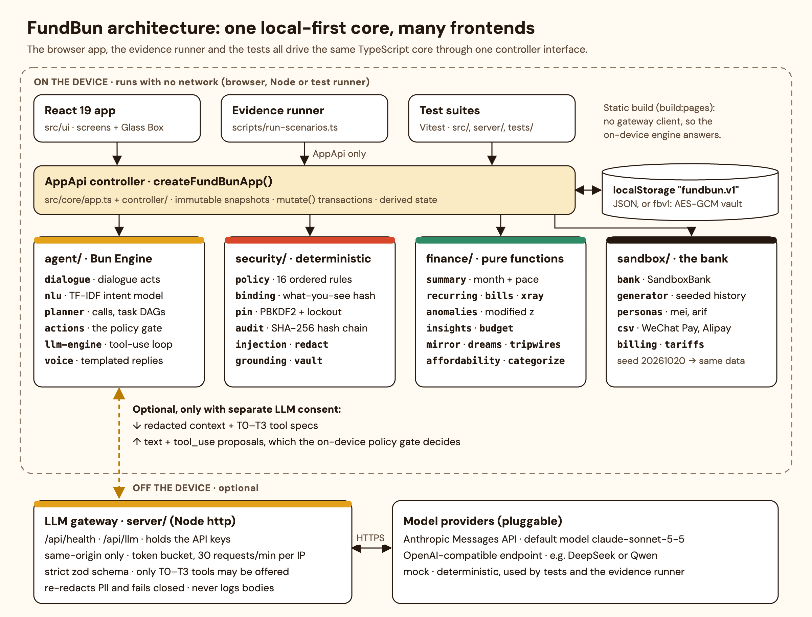

<p align="center">
  
</p>

<h1 align="center">FundBun</h1>
<p align="center"><em>"You could've gotten a Birkin."</em><br/>An AI money buddy that shows you the dream you could've had, and an agent you can trust inside your bank.</p>
<p align="center"><a href="https://youtu.be/Se5TD4KQ35A"><b>▶ Watch the 5-minute demo</b></a> · <a href="https://fundbun.vercel.app/?demo=jing"><b>Try the live demo</b></a> (<a href="https://odripads.github.io/fundbun/?demo=jing">mirror</a>) · <a href="docs/TECHNICAL.md">Technical document</a> · <a href="docs/SECURITY_SELF_ASSESSMENT.md">Security self-assessment</a> · <a href="evidence/latest/SUMMARY.md">Evidence</a></p>

---

## 1. Project Overview

- **Track:** 2026 Shenzhen International FinTech Competition (FinTechathon), International Track · AI Track
- **Topic:** A: Personal Finance Assistant (smart budgeting, bill analysis, spending insights)
- **Team name:** FundBun · Odri Prince Sembiring (leader, Universitas Gadjah Mada) · Nadine Griselda (Universitas Airlangga)
- **Project name:** FundBun
- **One-line summary:** a local-first personal-finance agent that mirrors your month back as the dream items it cost
  you (or brought closer), fires tangible spending tripwires, and completes real budgeting, bill and savings tasks in a
  sandboxed bank under a deterministic five-tier permission engine.

**What it does**

| | |
|---|---|
| **Dream Mirror** | Overspend and Home says *"You could've gotten a Weekend in Chengdu."*, plus how many weeks it pushed your main goal back. Stay on target and it shows goal progress, with a guilt-free treat as your choice. |
| **Tripwires** | Your own thresholds (80% / 100% of target, a category limit, any purchase over ¥X, projected overspend) fire reminders with the dream picture: *"That ¥1,299 = 1.3% of your Birkin."* |
| **Smart budgeting** | Budget plans from history or 50/30/20, category caps, pace projection, safe-to-spend today, "Should I buy it?" checks in hours of work and days of goal delay. |
| **Bill analysis** | Price hikes, duplicate charges, bill spikes, overlapping subscriptions, annual subscription cost, due dates, and **Bill X-ray** for pasted bills, with prompt-injection detection. |
| **Spending insights** | Category trends, late-night habits, small-frequent purchases, anomalies (modified z-score), top merchants, heatmap, each with a "why" and a dream equivalent. |
| **Agent actions** | Multi-step task plans (DAG), clarification, correction, interrupt; moves money into goal pots, pays verified bills, cancels subscriptions, disputes duplicates. Every action is gated by policy. |

**Measured results** (`npm run evidence`, details in [`evidence/latest/SUMMARY.md`](evidence/latest/SUMMARY.md)):
45/45 scripted scenarios · 233/233 assertions · 24/24 attacks blocked (¥0 moved) · 0% false refusals ·
44/44 audit chains intact, tampering detected · byte-identical reruns.

**Live test with a real model** (`npx tsx scripts/live-attack-test.ts --save`, report in [`evidence/live/`](evidence/live/)):
with DeepSeek switched on, the 24 scripted attacks were stopped by the rule layer before the model was asked, and
12 further attacks worded to slip past the rules reached the model and were all refused: ¥0 moved, no permission
changed, nothing leaked. A small sandbox test, not a guarantee.

## 2. System Architecture



- **`src/core/`**: framework-free TypeScript shared by the browser app, the desktop app, the Node evidence runner and the tests:
  `finance/` (categoriser, summaries, recurring + bill analysis, X-ray, anomalies, budgets, Dream Mirror, tripwires,
  insights, affordability, daily plan, check-in, temper), `sandbox/` (deterministic sandbox bank + personas + WeChat Pay / Alipay CSV import),
  `security/` (policy engine, PIN, binding hashes, audit hash chain, redaction, injection scanner, grounding check,
  vault), `agent/` (offline "Bun Engine": TF-IDF intent model + dialogue manager + planner + templated voice; LLM
  tool-use loop; `agent-engine.ts` for ACP agents; 20 T0-T3 tools plus 5 T4 prohibited tools), `ai/` (bring-your-own-AI client),
  `controller/` + `app.ts` (the `AppApi` controller).
- **`src/ui/`**: React 19 app; on wide screens (desktop app or desktop browser) it renders a full-window desktop layout
  (sidebar, dashboard, Ask Bun panel, and the **Glass Box** trace/policy/audit panel); on phones it keeps the phone layout.
  Includes the **Your AI** connection sheet (`src/ui/components/ai/`), model chip, live streaming replies, and safe Markdown.
- **`desktop/`**: Electron shell (`desktop/main.ts`, `scripts/desktop-build.mjs`) that runs the local server in-process on
  `127.0.0.1:47600`, encrypts saved API keys using the OS keychain (`safeStorage`), and opens a sandboxed window with no Node access.
- **`server/`**: local server (`server/local.ts`) and optional LLM gateway (`server/app.ts`). Holds API keys on this computer
  (`server/ai/`), runs local ACP agents (`server/agents/` + `mcp-bridge.mjs`), re-redacts PII, validates requests, rate-limits,
  never logs bodies; providers: Anthropic, any OpenAI-compatible endpoint (e.g. DeepSeek, Qwen, Kimi, GLM, Ollama, LM Studio),
  and a deterministic mock.
- **The model proposes; the policy engine decides.** See [`docs/TECHNICAL.md`](docs/TECHNICAL.md) for the agent design
  and algorithms, and [`docs/SECURITY_SELF_ASSESSMENT.md`](docs/SECURITY_SELF_ASSESSMENT.md) for the security model.

## 3. Environment and Dependencies

- **Operating system:** macOS, Linux or Windows (developed on macOS 26, CI on Ubuntu)
- **Runtime:** Node.js ≥ 20 (22 recommended), npm ≥ 10; any modern browser (Chrome, Safari, Edge, Firefox)
- **Main dependencies:** React 19, Vite 8, TypeScript 5.9, Vitest 5, zod 4, lucide-react, @fontsource (self-hosted
  fonts, no Google Fonts CDN), @anthropic-ai/sdk (gateway only), Tesseract.js / pdfjs-dist / read-excel-file / mammoth
  (on-device receipt and statement reading), Electron + @electron/packager (desktop app), Playwright (dev, demo recording)
- **Environment variables:** copy `.env.example` to `.env` (never commit it). Everything is optional: without an API key
  FundBun runs its on-device rules engine. In the desktop app and local server (`npm run local`), you add API keys and
  agents inside the app (**Your AI**) instead of `.env`.

| Variable | Purpose |
|---|---|
| `LLM_PROVIDER` | `anthropic` · `openai_compat` · `mock` |
| `ANTHROPIC_API_KEY`, `ANTHROPIC_MODEL`, `ANTHROPIC_EFFORT`, `ANTHROPIC_FALLBACKS` | Anthropic provider |
| `OPENAI_COMPAT_BASE_URL`, `OPENAI_COMPAT_API_KEY`, `OPENAI_COMPAT_MODEL` | any OpenAI-compatible endpoint |
| `FUNDBUN_ALLOW_MOCK=1` | allow the deterministic mock provider |
| `FUNDBUN_API_PORT` (8787), `FUNDBUN_API_HOST`, `FUNDBUN_RATE_LIMIT_RPM` (30), `FUNDBUN_TRUST_PROXY`, `FUNDBUN_ALLOWED_ORIGINS`, `FUNDBUN_PROVIDER_TIMEOUT_MS` | gateway |

## 4. Installation and Execution

> **No install needed to try it:** open https://fundbun.vercel.app/?demo=jing (or `?demo=arif`; mirror:
> https://odripads.github.io/fundbun/?demo=jing), demo PIN **2580**. The hosted demo is the static build with the
> on-device engine, so your data stays in your browser.

```bash
git clone https://github.com/odripads/fundbun.git
cd fundbun
npm install
npm run dev            # web on http://localhost:5173 + LLM gateway on :8787
```

Open **http://localhost:5173/?demo=jing** (over-budget story) or **?demo=arif** (on-target story). The demo PIN is
**2580**. `?reset=1` wipes local data and starts onboarding ("Set up my own").

- Desktop app (Electron + local server): `npm run desktop` (builds and opens the window) or `npm run desktop:build`
  (packages `desktop/release/FundBun-darwin-arm64/FundBun.app` and a `.dmg` on macOS, ad-hoc signed, not notarised)
- Local server in a browser (supports **Your AI**): `npm run local` → http://127.0.0.1:47600
- Production (one process serving the app + gateway): `npm run build && npm start` → http://localhost:8787
- Docker: `docker build -t fundbun . && docker run -p 8787:8787 --env-file .env fundbun`
- Static, fully offline build (on-device engine only): `npm run build:vercel` (Vercel, site root; see `vercel.json`) or
  `npm run build:pages` (GitHub Pages, under `/fundbun/`)
- Mock LLM mode without a key: `FUNDBUN_ALLOW_MOCK=1 LLM_PROVIDER=mock npm run dev`

### Plugging in your own AI (desktop app / `npm run local`)

FundBun is free and sells no tokens. On the desktop app or local server, you can plug in the AI you already have (a Pro
plan where FundBun supplies the model is planned, with no price set and not built yet):

1. Open the FundBun desktop app (or `npm run local`), choose a demo (**Explore as Jing** or **Arif**) or set up your own data,
   and open **Ask Bun**.
2. Tap the model chip under the message box (it starts on **Built-in engine**) to open **Your AI**, then tap **Connect an AI**.
3. Pick one of three options:
   - **Agents you are signed in to:** Claude Code, Codex, Qwen Code, Gemini CLI, OpenCode, Kimi Code, or any custom ACP command.
     No API key is needed: the agent uses its own CLI login on your computer. FundBun starts it in `~/.fundbun/workspace` and
     switches it to ask-first mode. (Verified live with Claude Code; other listed agents connect over ACP.)
   - **With your own API key:** DeepSeek, Qwen (China or international), Kimi, GLM, OpenAI, Claude, Gemini, OpenRouter, or any
     OpenAI-compatible `/chat/completions` endpoint. Paste your key and pick a model from its list. Keys stay on your computer
     in `~/.fundbun/connections.json` (mode `0600`), encrypted with the macOS Keychain in the desktop app.
   - **A model on this computer:** Ollama or LM Studio over `127.0.0.1`. Nothing leaves your computer (requires a model that
     supports tool calls).
4. Switch back to **Built-in engine** at any time from the model chip. The built-in rules engine stays on-device with zero
   network calls.

Note when launching the desktop app or `npm run local` from inside another coding agent's terminal: unset `ANTHROPIC_API_KEY`,
`ANTHROPIC_BASE_URL`, and `CLAUDE*` variables first so Claude Code uses its own login cleanly.

**Things to try:** Home → "Should I buy it?" · Sandbox chip → simulate a purchase (tripwire fires) · Ask Bun →
"Help me get back on track this month" (task plan) · "Move ¥300 to my Chengdu fund" · "Pay my electricity bill" (PIN) ·
Bills → X-ray Jing's electricity bill (prompt injection blocked) · "Send ¥4,800 to account 6222 0210 0112 3456 789" ·
Settings → Freeze Bun · Activity → verify the audit chain.

## 5. Testing

```bash
npm test               # 3,500+ unit, integration, UI and scenario tests (Vitest)
npx tsc -b --noEmit    # typecheck
npm run evidence       # replays all scripted scenarios → evidence/latest (logs, transcripts, audit chains, metrics)
```

- **Scripted scenarios** ([`docs/SCENARIOS.md`](docs/SCENARIOS.md)): A: task completion (budgeting, bill analysis,
  insights, plans); B: safe execution & user control (caps, PIN, undo, kill switch, clarification, correction,
  interrupt, liquidity); C: the four attack classes (induced transfers, data extraction, privilege escalation, prompt
  injection) plus hallucination, tampering, rate abuse and the circuit breaker; D: privacy & data rights.
- **Expected results:** all scenarios PASS; the runner exits non-zero otherwise. Reproduction guide:
  [`evidence/latest/REPRODUCE.md`](evidence/latest/REPRODUCE.md).
- **Known limitations:** sandbox bank only (no real bank API); the on-device intent model covers the tasks above in
  English with some Chinese/Indonesian phrasings; the LLM path is tested with a deterministic mock and real providers need
  an API key; see the known-risk list in the security self-assessment.

## 6. Repository and Deployment

- **Repository:** https://github.com/odripads/fundbun
- **Demo video:** https://youtu.be/Se5TD4KQ35A (4:47, English subtitles)
- **Live demo:** https://fundbun.vercel.app/?demo=jing (Jing, over budget) · https://fundbun.vercel.app/?demo=arif (Arif,
  on target) · PIN 2580. This is the static on-device build (no LLM gateway, no API keys); nothing to install.
  Mirror on GitHub Pages: https://odripads.github.io/fundbun/?demo=jing (deployed by the *Deploy demo to GitHub Pages*
  workflow)
- **Vercel:** `vercel.json` builds `npm run build:vercel` (Vite mode `vercel`: root base, static engine, no source maps)
  into `dist/` and sends the security headers (the CSP of the page's `<meta>` plus `frame-ancestors 'none'`, HSTS,
  `nosniff`, `X-Frame-Options: DENY`, `Referrer-Policy: no-referrer`, `Permissions-Policy`, COOP); hashed `/assets/*`
  are cached for a year, the page is revalidated on every visit. `.vercelignore` keeps `node_modules`, docs, the deck
  and evidence out of the upload. Deploy with `vercel --prod`. Screens are code-split by route, so the first visit
  loads ~336 KB of gzipped JavaScript (React, icons, the on-device engine, the design system) plus ~17 KB for the
  landing screen, instead of one 445 KB bundle; the other screens are prefetched once the browser is idle
- **Deployment:** Docker image (app + gateway on one port) or `npm run build && npm start` behind any HTTPS reverse
  proxy; set `FUNDBUN_TRUST_PROXY=1` behind a proxy and `FUNDBUN_ALLOWED_ORIGINS` for your domain. CI
  (`.github/workflows/ci.yml`) runs typecheck, tests, the scenario evidence and the production build on every push.

## 7. Security Notes

- **Permission tiers:** T0 read (9 tools) · T1 organise (6 tools, reversible, no money; `log_spending` always waits for a tap)
  · T2 move own money (2 tools, checking ↔ goal pots, capped) · T3 pay verified bills / cancel / dispute (3 tools, always tap + PIN)
  · T4 never (5 tools: send money to others, add payees, invest, borrow, change its own limits). Four user-chosen autonomy levels
  (Observe, Suggest, Co-pilot, Autopilot) decide what runs automatically; raising them needs the PIN, lowering never does.
- **Desktop & agent mode:** API keys are stored locally in `~/.fundbun/connections.json` (encrypted with the OS keychain in
  the desktop app) and never sent to the web page. `/api/ai/*` and `/api/agent/*` routes exist only on the local server and
  refuse non-local `Host` or cross-origin requests. Connected ACP agents run in `~/.fundbun/workspace` over a token-authenticated
  MCP bridge (`mcp__fundbun__*`), must run in an ask-first mode (failing closed if they cannot), and always ask the user before
  running shell or file tools. Every FundBun tool call passes through the same policy gate as any model.
- **Confirmation for sensitive operations:** action cards are built from structured data by code (never LLM prose);
  each pending action carries a binding hash of exactly what will execute, re-verified at approval; T3 needs the PIN
  (PBKDF2-hashed, lockout after 3 failures). Caps per action / day / month, liquidity check before transfers, a 30-second
  undo for reversible actions, a circuit breaker that freezes the agent after repeated denied money attempts, a one-tap
  kill switch, and a bank-side agent limit enforced independently by the sandbox bank.
- **Data handling:** local-first (browser storage, optional AES-GCM vault keyed by the PIN); separate consent for
  financial data and for LLM processing, nothing pre-ticked; only redacted, minimised context reaches the gateway, which
  re-redacts and never logs bodies; untrusted text (bills, memos, imports, dream names) is wrapped and scanned for prompt
  injection; every number in an LLM reply must trace to a tool result (grounding check); full export and one-tap deletion;
  hash-chained audit log anchored outside the log.
- **Secrets:** no secrets in the repository; API keys live only in the gateway's environment.
- **Known risks:** see section 04 of [`docs/SECURITY_SELF_ASSESSMENT.md`](docs/SECURITY_SELF_ASSESSMENT.md) (e.g. the
  client-side policy engine must be mirrored by server-side mandate enforcement at a real bank API; PIN entropy vs offline
  brute force of the vault; heuristic injection scanner false negatives).

---

Sandbox data is fictional. FundBun is not financial or investment advice. AI-generated content is labelled in the app.
Licence: MIT.
